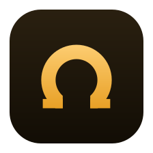
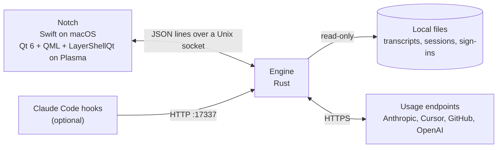

<div align="center">



# Omega Notch

### Your AI coding tools' limits and live sessions, in a notch on your Mac or on KDE Plasma.

**Claude Code, Cursor, Claude Desktop, GitHub Copilot, Codex and Grok Bot. Read from your own computer.**

[](https://github.com/joaomdsferro/omega-notch/releases)
[](https://github.com/joaomdsferro/omega-notch/actions/workflows/release.yml)
[](#macos)
[](#kde-plasma)
[](#how-it-works)
[](LICENSE)

[Install](#install) · [Features](#features) · [How it works](#how-it-works) · [Privacy](#privacy) · [FAQ](#faq) · [Contributing](CONTRIBUTING.md)

</div>

---

> [!WARNING]
> **Early test version (v0.0.x).** Expect bugs, missing features and settings that change between
> versions. Omega Notch is an unofficial tool, not affiliated with Anthropic, Anysphere (Cursor),
> GitHub, OpenAI or xAI. It reads usage the way their own apps do, from accounts you are already
> signed in to.

Omega Notch is a small notch fused to an edge of your screen, part of the open-source
[Omega](#about-omega) family. It shows how much of each AI coding tool's limit you have used, which
sessions are working right now, and tells you when one finishes or needs you. Inspired by
[Codenotch](https://github.com/vinzdg/codenotch): one Rust engine, with a native shell for each
desktop, Swift on macOS and Qt 6 / QML on KDE Plasma (Wayland).

## Install

### macOS

Omega Notch needs **macOS 14 Sonoma or later**, on Apple silicon or Intel.

With [Homebrew](https://brew.sh):

```sh
brew install --cask joaomdsferro/tap/omega-notch
```

`brew upgrade --cask omega-notch` brings later versions. Or download
`omega-notch-<version>-macos-universal.dmg` from the
[latest release](https://github.com/joaomdsferro/omega-notch/releases), open it and drag
**Omega Notch** to Applications. Either way the app is signed and notarised, so it opens without
warnings.

- The first time it reads your Claude Code sign-in, macOS asks for Keychain access. Choose
  **Always Allow**.
- Jumping to a chat's window needs Accessibility, which Settings asks for when you switch it on.
- **Open at login** is in Settings.
- It updates itself: once a day it checks for a new version and asks before installing it. Settings
  → General has **Check now**.

To remove it, run `brew uninstall --cask omega-notch` (add `--zap` to delete its settings too), or
quit it and move it to the Trash.

### KDE Plasma

Omega Notch needs **KDE Plasma 6 on Wayland**.

**Arch, CachyOS, EndeavourOS and other Arch-based distributions:** download
`omega-notch-<version>-linux-x86_64.tar.gz` from the
[latest release](https://github.com/joaomdsferro/omega-notch/releases), then:

```sh
sudo pacman -S --needed qt6-base qt6-declarative qt6-wayland layer-shell-qt libnotify python
tar xzf omega-notch-*-linux-x86_64.tar.gz
cd omega-notch-*-linux-x86_64
./install.sh
omega-notch
```

It installs to `~/.local/bin` (no `sudo`), adds a menu entry, and starts with Plasma from then on.

**Fedora KDE, openSUSE, KDE neon and others:** the download is built against Arch's Qt, so
[build from source](#build-from-source) instead. It takes a couple of minutes.

To remove it, run `./uninstall.sh` from the same folder.

## Features

- A notch fused to any edge of any screen, in black or any colour. It hides behind a small nub until
  a session finishes or the pointer touches its edge, or stays on screen if you prefer
- One ring per tool, up to five: the ones working right now first, then the most recently used, each
  showing how much of its limit is gone. Scroll on the notch to bring up the others
- A white arc orbits inside a ring while a session works, and turns into a breathing amber ring when
  one is waiting on you
- Hover a ring for its card:
  - every limit window, with its reset time
  - **tokens today** (input, output, cache), the last seven days, and the split per model
  - **recent chats**: title, project, model, tokens spent, and which ones are working or need you.
    Click one to jump to it: the terminal or VS Code window running it, or a new one resuming it
- The card opens by itself for a few seconds, with a sound, when a session finishes or asks
  something, and when a tool's main limit passes 80% and when it reaches 100%. System
  notifications for these are optional and off by default
- A **dashboard** window, from the bars button in the notch's footer: every limit, estimated cost and
  tokens per day over 7, 30 or 90 days (by model, by tool or by kind), each model's share of the
  spend, today's mix, the dearest sessions with each one's models, and the recent chats. History
  starts with every Claude Code day still on disk. Costs are estimates at API list prices, not a bill
  - Its charts and tables come in greys, a vivid palette or a colour-blind safe one (Okabe–Ito), and
    any series can have a colour of its own, in Settings → Notch
  - Narrow the whole page to one project, one chat, or a search by title, folder or model: costs,
    tokens, models, sessions and chats then cover only those Claude Code sessions, cheap ones too
  - Suggestions from local rules over those sessions, with what each would roughly have saved: small
    jobs run on a top model, a prompt cache rebuilt more than reused, a very long session, a chat
    near its context limit. Each can narrow the page to the chat it is about, or open it. On
    request, Claude (Sonnet or Opus, through your own `claude` and subscription) adds its own advice
- **Chats to read.** A chat that finished since you last looked at it gets a green badge on its
  tool's ring (a green dot on the nub, or under the camera housing, while the notch is tucked away)
  and its own "To read" list in the card and the dashboard. It counts as read once you open it from
  the notch, write in it again, or (on macOS) bring its window or tab to the front while you are at
  the Mac. Claude Code only, for now: other tools do not say when they last replied
- Click a ring to refresh it; hover the notch for Settings and a grip to slide it along the edge;
  right-click opens Settings
- Only the notch takes input; the rest of the edge stays click-through
- A failed refresh keeps the last good numbers instead of blanking the ring

### Where the data comes from

| | Limits | Live sessions | Chats | Tokens |
|---|---|---|---|---|
| **Claude Code** | OAuth usage endpoint (sign-in from the login Keychain on macOS) | `~/.claude/sessions/*.json` | `~/.claude/projects/**/*.jsonl` | the same transcripts |
| **Cursor** | usage summary endpoint | recent agent files (best effort) | `composerHeaders` in `state.vscdb` | context % and lines changed only |
| **Claude Desktop** | `~/.config/Claude/plan-usage-history.json` (no reset times) | — | — | — |
| **GitHub Copilot** | `copilot_internal/user` endpoint (premium requests, or chat/completions on Free) | VS Code Copilot Chat transcripts (best effort) | — | — |
| **Codex** | `wham/usage` endpoint (5h + weekly, or monthly on Free) with the ChatGPT sign-in from `~/.codex/auth.json` | — | — | — |
| **Grok Bot** | `GetSandUsageStatus` on Cursor's dashboard API (weekly included usage), with your Cursor sign-in | — | — | — |

On macOS, the folders under `~/.config` in this table are under `~/Library/Application Support`
instead, such as `~/Library/Application Support/Claude` and `~/Library/Application Support/Cursor`.

Grok Bot runs on Cursor's backend and keeps its own token in the system keyring, so its ring uses the
Cursor account signed in to `state.vscdb`. It fills in when Cursor and Grok Bot use the same account.

To sign in to Copilot, open Settings and click **Sign in to GitHub Copilot**. GitHub's page opens with
the code already on the clipboard; paste it, confirm, and the ring fills in. A sign-in another Copilot
client already saved is picked up as well: `~/.config/github-copilot/apps.json` / `hosts.json`
(copilot.vim, copilot.lua, JetBrains) or `~/.local/share/opencode/auth.json`.

Codex's ring uses the ChatGPT sign-in Codex already saved in `~/.codex/auth.json` (or `$CODEX_HOME`),
read-only. Codex refreshes that token itself; if it has expired, opening Codex once brings the ring back.

## How it works



The engine polls each tool, watches its session files and keeps the numbers; the notch only draws
them. They talk over a small [socket protocol](protocol/README.md), so other shells can plug in later.
Transcripts are parsed incrementally, so a long session costs only the bytes appended since the last look.

```
ui/macos                    Swift / SwiftUI notch (macOS 14+)
ui/plasma                   Qt 6 QML notch (LayerShellQt)
crates/omega-notch-engine   socket server, hook HTTP on 127.0.0.1:17337
crates/omega-notch-core     providers, poller, session watchers
protocol/                   wire format
packaging/                  installer, desktop entry, icons
```

## Privacy

- Everything except the usage endpoints is read from local files, read-only.
- The only network requests go to each tool's own usage endpoint, with the sign-in that tool already
  saved. Nothing goes to a server of ours, because there is none.
- On macOS, the downloaded app also checks GitHub once a day for a newer release (you can switch
  that off in Settings → General). It asks before installing anything, and installs only updates
  signed with the project's key. The check sends nothing about you or your usage.
- The Copilot sign-in made through the notch is kept in `~/.local/share/omega-notch/copilot.json`
  (mode 600). Settings live in `~/.config/omega-notch/config.json`. On macOS both are in
  `~/Library/Application Support/omega-notch`.
- The dashboard's daily token history is kept in `history.db`, in the same folder as the Copilot
  sign-in: token counts per day and model, and per Claude Code session with its title, project
  folder and where it ran. No chat content is kept. Session rows are deleted once they are more than
  90 days old.
- Which finished chats you have read is kept in `seen.json` in the same folder (mode 600): chat ids
  and when you last looked at each, for 30 days. On macOS, while a finished chat is still to read
  and you are using the Mac, the app tells the engine which app is in front and, with
  Accessibility, its window's title, so it can tell when you are looking at that chat. That
  stays on your Mac, goes no further than the engine, and is not stored.
- "Ask Claude" in the dashboard's Suggestions sends Anthropic, through your own `claude` command,
  only numbers: totals, ratios, models, cost per day and the dearest sessions as S1, S2… No title,
  folder, project name or chat text. It runs with no tools and does not save a session. Nothing is
  sent unless you press it.
- The hook server listens on `127.0.0.1` only.

## Build from source

On macOS, see [Contributing](CONTRIBUTING.md#on-macos): `make macos` builds the app.

On Linux, the requirements are: Rust (stable), CMake, Ninja, Qt 6.5+ (Base, Declarative, Wayland) and LayerShellQt.

```sh
# Arch / CachyOS
sudo pacman -S --needed rust cmake ninja qt6-base qt6-declarative qt6-wayland layer-shell-qt

# Fedora
sudo dnf install rust cargo cmake ninja-build qt6-qtbase-devel qt6-qtdeclarative-devel \
  qt6-qtwayland-devel layer-shell-qt-devel

make run       # build and run from the repository
make install   # build and install to ~/.local/bin, with Plasma autostart
make doctor    # check what each provider can see
```

## Claude Code hooks (optional)

Recent Claude Code keeps a session registry the notch reads directly, so no hooks are needed. For older
builds, add a Stop / Notification hook that calls:

```sh
omega-notch-claude-hook idle "session done"
# kinds: busy | waiting_you | idle
```

Or POST JSON to `http://127.0.0.1:17337/hooks/session`. See [docs/claude-hooks.md](docs/claude-hooks.md).

## FAQ

<details>
<summary><strong>A ring stays empty. What's wrong?</strong></summary>

Run `omega-notch-engine doctor` (on macOS,
`"/Applications/Omega Notch.app/Contents/Helpers/omega-notch-engine" doctor`). It lists every provider, the files it looked for and whether it found
a sign-in. Most often the tool isn't signed in on this computer, or its token has expired; opening the
tool once usually fixes it.
</details>

<details>
<summary><strong>Does it work on GNOME, Sway or X11?</strong></summary>

Not yet. On Linux the notch is a layer-shell surface built and tested on KDE Plasma 6 on Wayland, and
jumping to a chat uses KWin. Other compositors may draw it, but only macOS and Plasma are supported
for now.
</details>

<details>
<summary><strong>I used Mega Notch before. Do I lose my settings?</strong></summary>

No. Mega Notch was this app's earlier name. The installer removes the old binaries and autostart entry,
and the engine moves `~/.config/mega-notch` and `~/.local/share/mega-notch` to their new names on its
first start.
</details>

<details>
<summary><strong>How do I remove it?</strong></summary>

On macOS, run `brew uninstall --cask --zap omega-notch`, which removes its settings too. Without
Homebrew, quit it and move it to the Trash; settings stay in
`~/Library/Application Support/omega-notch`, so delete that folder to remove everything.

On Linux, run `./uninstall.sh` from the release folder, or `make uninstall` from the repository.
Settings stay in `~/.config/omega-notch` and `~/.local/share/omega-notch`; delete those folders to
remove everything.
</details>

<details>
<summary><strong>I found a bug. What should I do?</strong></summary>

[Open an issue](https://github.com/joaomdsferro/omega-notch/issues/new/choose) with what you did, what
happened, your macOS version or Linux distribution and the output of `omega-notch-engine doctor`. Never paste tokens, the
contents of `auth.json` or `.credentials.json`, or your chats.
</details>

## Documentation

- [Protocol](protocol/README.md): the socket protocol between the engine and the notch
- [Claude Code hooks](docs/claude-hooks.md): for Claude Code builds without the session registry
- [Contributing](CONTRIBUTING.md): setting up, conventions and pull requests
- [Security](SECURITY.md): reporting a vulnerability

## About Omega

Omega is a family of open-source apps by the Wisething team and anyone who wants to contribute. Each
app is small, native and private by default. Omega Notch joins [Omega Zap](https://github.com/joaomdsferro/omega-zap).

## Disclaimer

Omega Notch is not affiliated with, endorsed by or connected to Anthropic, Anysphere, Apple, GitHub,
Microsoft, OpenAI or xAI. Their names and marks belong to their owners.

## License

[MIT](LICENSE)
