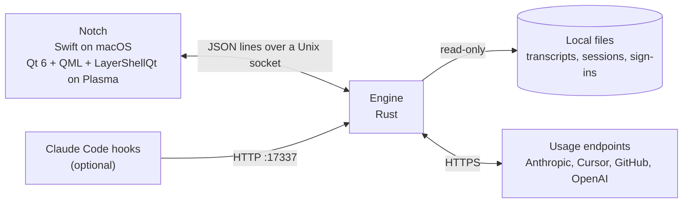

# How it works



The engine polls each tool, watches its session files and keeps the numbers; the notch only draws
them. They talk over a small [socket protocol](../protocol/README.md), so other shells can plug in later.
Transcripts are parsed incrementally, so a long session costs only the bytes appended since the last look.

```
ui/macos                    Swift / SwiftUI notch (macOS 14+)
ui/plasma                   Qt 6 QML notch (LayerShellQt)
crates/omega-notch-engine   socket server, hook HTTP on 127.0.0.1:17337
crates/omega-notch-core     providers, poller, session watchers
protocol/                   wire format
packaging/                  installer, desktop entry, icons
```
